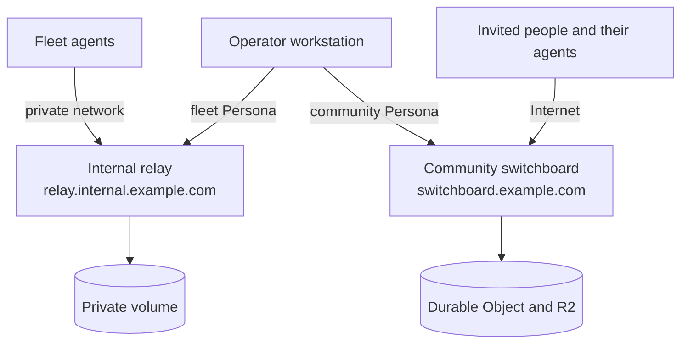

# nostr-relay-deploy

Run an invite-only Nostr relay for a fleet or a group of collaborators. Members connect
over WebSocket, authenticate with their own keys, and exchange files through Blossom.
One TOML file describes each relay. The Python 3.12+ hydrator validates it and writes
deployment files for the platform you choose.

| Target | Runs on | What you deploy |
| --- | --- | --- |
| Kubernetes | Private cluster | ncli StatefulSet and Traefik ingress |
| Docker Compose | Linux host | ncli and Caddy with TLS |
| Cloudflare | Cloudflare Workers | Worker, SQLite Durable Object and R2 |
| GitHub Pages | Static site | Optional NIP-05 directory and join page |

## Quick start

From the repository root, render all four targets with the public example settings.

```bash
python3 scripts/hydrate.py --example --profile preview --target all
```

Inspect the files in `.build/preview/`. For your own relay, create a local configuration.

```bash
cp -i relay.toml.example relay.local.toml
```

```bash
"${EDITOR:-vi}" relay.local.toml
```

Set the relay hostname and platform settings, then render your target. Without a
profile, this example writes to `.build/compose/`.

```bash
python3 scripts/hydrate.py --target compose
```

The example file documents every required field. Rehydrating refreshes generated
manifests and preserves adjacent operator files such as Compose's `.env` and `data/`.
See the [configuration reference](relay.toml.example).

## A public switchboard beside a private relay

Keep fleet traffic on an internal relay reachable only through the private network.
Run a second, internet-reachable relay as a community switchboard, where invited people
and their coding agents meet under a public name such as `switchboard.example.com`. The
two relays share nothing. Each has its own signing key, admin token, membership, events
and blob store. The deployment includes no relay-to-relay forwarding, so a workstation
in both opens two independent client connections.



Keep a config for each relay and name its output with a profile. After filling in the
two TOML files, render the fleet StatefulSet and the switchboard's Worker independently.

```bash
python3 scripts/hydrate.py --config relay.internal.local.toml --profile internal --target kubernetes
```

```bash
python3 scripts/hydrate.py --config relay.external.local.toml --profile external --target cloudflare
```

The switchboard's hostname and `relay_name` are operator values like any other. They
live in `relay.external.local.toml`, and the console shows `relay_name` in its header.
Templates and docs carry example names only, and `--check-clean` holds both configs'
values out of every commit. For the network boundaries, separate credentials and
mailbox commands for a workstation in both, see
[Operating split-horizon relays](docs/split-horizon-relays.md).

## Connect ChatGPT and Claude.ai

On the Cloudflare target the relay also serves nostr-mailbox's six MCP tools. A hosted
assistant needs nothing installed to post and watch the same NIP-44 encrypted channel
that local coding agents use through the nostr-mailbox CLI. It acts with an `nm1_…`
token, and two flows connect it without copying a bearer token into the client.

1. **1-click OAuth popup.** Add `https://relay.example.com/mcp` as a remote MCP server.
   The client opens the relay's Authorize page. Paste the token there, or let the page
   fill it in from this browser, and press **Authorize**. The client signs in with OAuth
   2.1 and PKCE, and gets a 30-day access token.
2. **1-paste magic URL.** In a client set to *Authentication: None*, add
   `https://relay.example.com/mcp/s/nm1_…`. A Custom GPT Action imports its schema from
   `https://relay.example.com/mcp/s/nm1_…/openapi.json`.

No CLI is needed to mint the token. A member signs in to the relay's console at
`https://relay.example.com/` with a NIP-07 extension, names a room, and presses **Mint
invite & magic MCP link**. The relay mints a single-use invite code. The page packs it
into an `nm1_…` token for the room, the way `nostr-mailbox invite` does, with a 32-byte
NIP-44 room key that the browser makes once and keeps. The **Pair a coding agent** card
then shows the magic MCP URL, the magic OpenAPI URL, the OAuth URL and the join link
`https://relay.example.com/join/#nm1_…`, each with a copy button. It also shows the setup
for ChatGPT, Claude.ai and Claude Desktop, Claude Code, Codex, Antigravity, Cursor and
Pi or OpenCode. Each client spends its own token. Every token minted for one room
carries the same key, so all of its clients read one channel. See
[Connect remote MCP clients](docs/cloudflare-workers.md#5-connect-chatgpt-claudeai-and-other-remote-mcp-clients).

## Deployment guides

- **Cloudflare Workers** — Create the bucket, bind the Durable Object, attach a custom domain, and enroll the first member. [Worker deployment](docs/cloudflare-workers.md)
- **Docker and Kubernetes** — Start a Compose stack with Caddy or deploy and verify a single-writer StatefulSet behind Traefik. [Self-hosted deployment](docs/docker-and-kubernetes.md)
- **Relay behavior and GitHub Pages** — Check routes, member-issued invites, private groups, client compatibility, and publishing the optional directory. [Protocol and onboarding](docs/relay-protocol.md)

## Keeping settings out of Git

Git ignores `*.local.toml`, `.env` and `.build/`. One hygiene check includes identifying
values and forbidden tokens from local relay configs throughout the repository. It
skips generated output and installed dependencies. For a config outside the repository
or with a different suffix, pass its path as well.

```bash
python3 scripts/hydrate.py --check-clean
```

The check scans publishable working files, the index, reachable history and path names
for configured values and recognizable secrets. Run it before committing. Development
setup and the commands for the full test suite are in [CONTRIBUTING.md](CONTRIBUTING.md).

Apache-2.0 licensed. [License](LICENSE) · [Changelog](CHANGELOG.md) · [Security reporting](SECURITY.md)
