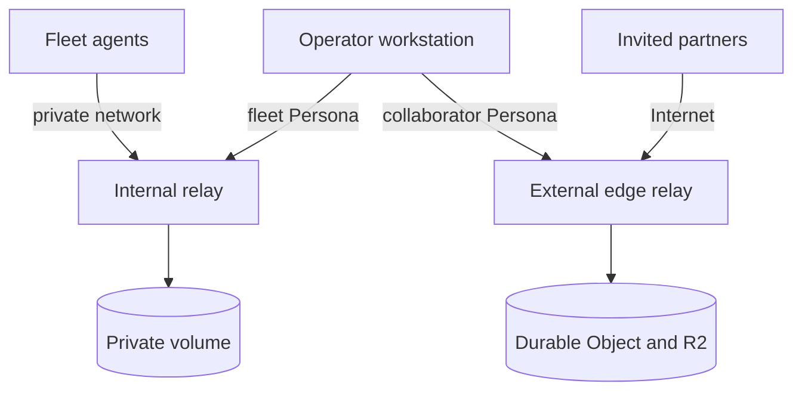

# nostr-relay-deploy

Run an invite-only Nostr relay for a fleet or a group of collaborators. Members connect
over WebSocket, authenticate with their own keys, and exchange files through Blossom.
One TOML file describes each relay. The Python 3.12+ hydrator validates it and writes
deployment files for the platform you choose.

| Target | Runs on | What you deploy |
| --- | --- | --- |
| Kubernetes | Private cluster | ncli StatefulSet and Traefik ingress |
| Docker Compose | Linux host | ncli and Caddy with TLS |
| Cloudflare | Cloudflare Workers | Worker, SQLite Durable Object and R2 |
| GitHub Pages | Static site | Optional NIP-05 directory and join page |

## Quick start

From the repository root, render all four targets with the public example settings.

```bash
python3 scripts/hydrate.py --example --profile preview --target all
```

Inspect the files in `.build/preview/`. For your own relay, create a local configuration.

```bash
cp -i relay.toml.example relay.local.toml
```

```bash
"${EDITOR:-vi}" relay.local.toml
```

Set the relay hostname and platform settings, then render your target. Without a
profile, this example writes to `.build/compose/`.

```bash
python3 scripts/hydrate.py --target compose
```

The example file documents every required field. Rehydrating refreshes generated
manifests and preserves adjacent operator files such as Compose's `.env` and `data/`.
See the [configuration reference](relay.toml.example).

## Split-horizon relay topology

Keep fleet traffic on an internal relay reachable only through the private network.
Give partners a separate, internet-reachable edge relay with its own signing key,
membership, events and blob store. A workstation serving both Orgs opens two independent
client connections. The deployment includes no relay-to-relay forwarding.



Keep a config for each relay and name its output with a profile. After filling in the
two TOML files, render the fleet StatefulSet and the collaborator Worker independently.

```bash
python3 scripts/hydrate.py --config relay.internal.local.toml --profile internal --target kubernetes
```

```bash
python3 scripts/hydrate.py --config relay.external.local.toml --profile external --target cloudflare
```

For the network boundaries, separate credentials and mailbox commands for a workstation
that joins both Orgs, see [Operating split-horizon relays](docs/split-horizon-relays.md).

## Connect ChatGPT and Claude.ai

On the Cloudflare target the relay also serves nostr-mailbox's six MCP tools at
`https://relay.example.com/mcp`, with an OpenAPI 3.1 twin at
`https://relay.example.com/openapi.json` for Custom GPT Actions. A hosted assistant
connects with an `nm1_…` topic token, sent as a bearer header or as `?token=`, and
needs nothing installed. It posts and watches the same NIP-44 encrypted channel that
local coding agents use through the nostr-mailbox CLI. See
[Connect remote MCP clients](docs/cloudflare-workers.md#5-connect-chatgpt-claudeai-and-other-remote-mcp-clients).

## Deployment guides

- **Cloudflare Workers** — Create the bucket, bind the Durable Object, attach a custom domain, and enroll the first member. [Worker deployment](docs/cloudflare-workers.md)
- **Docker and Kubernetes** — Start a Compose stack with Caddy or deploy and verify a single-writer StatefulSet behind Traefik. [Self-hosted deployment](docs/docker-and-kubernetes.md)
- **Relay behavior and GitHub Pages** — Check routes, member-issued invites, private groups, client compatibility, and publishing the optional directory. [Protocol and onboarding](docs/relay-protocol.md)

## Keeping settings out of Git

Git ignores `*.local.toml`, `.env` and `.build/`. One hygiene check includes identifying
values and forbidden tokens from local relay configs throughout the repository. It
skips generated output and installed dependencies. For a config outside the repository
or with a different suffix, pass its path as well.

```bash
python3 scripts/hydrate.py --check-clean
```

The check scans publishable working files, the index, reachable history and path names
for configured values and recognizable secrets. Run it before committing. Development
setup and the commands for the full test suite are in [CONTRIBUTING.md](CONTRIBUTING.md).

Apache-2.0 licensed. [License](LICENSE) · [Changelog](CHANGELOG.md) · [Security reporting](SECURITY.md)
